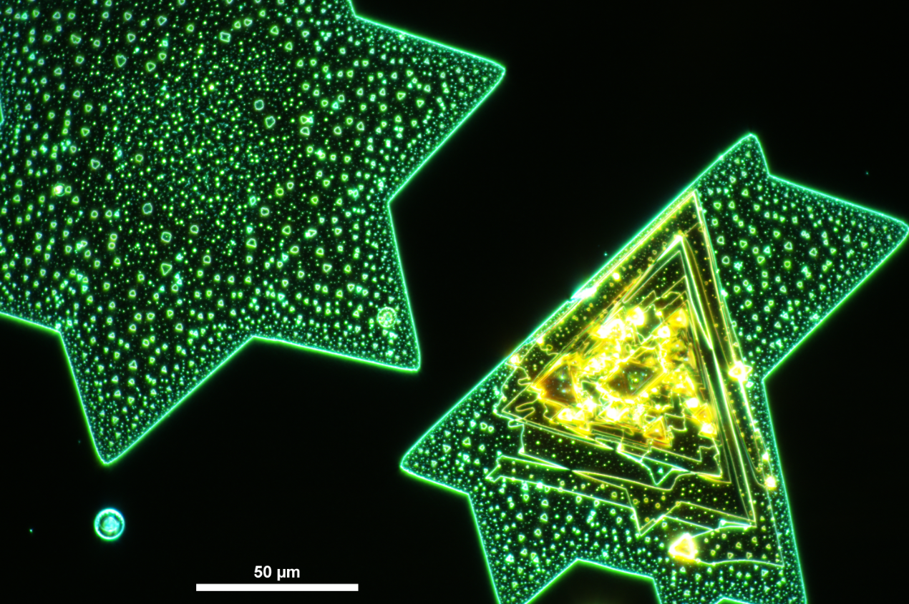
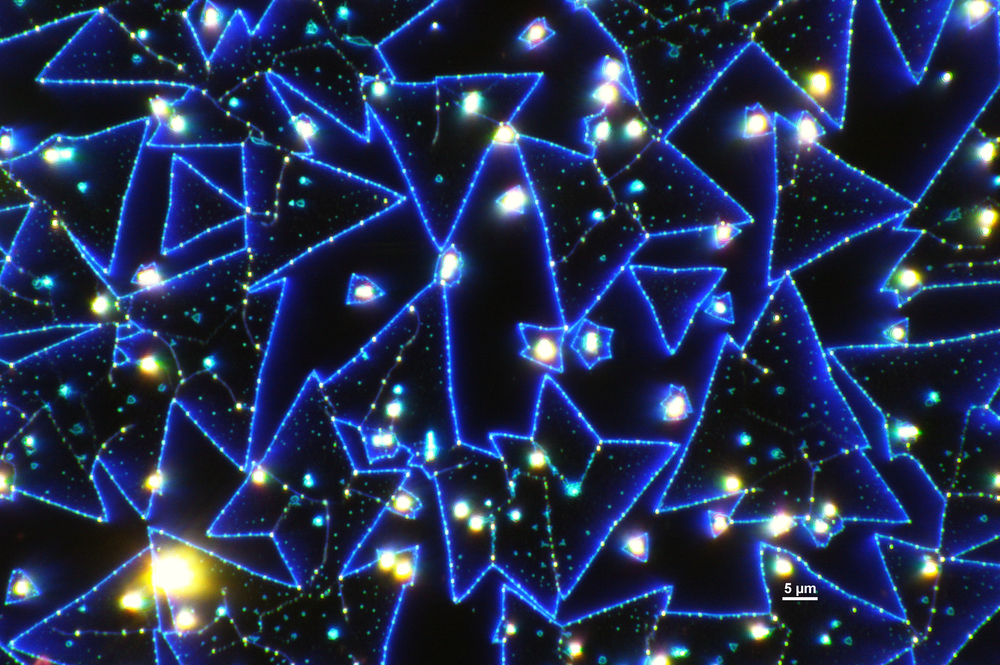
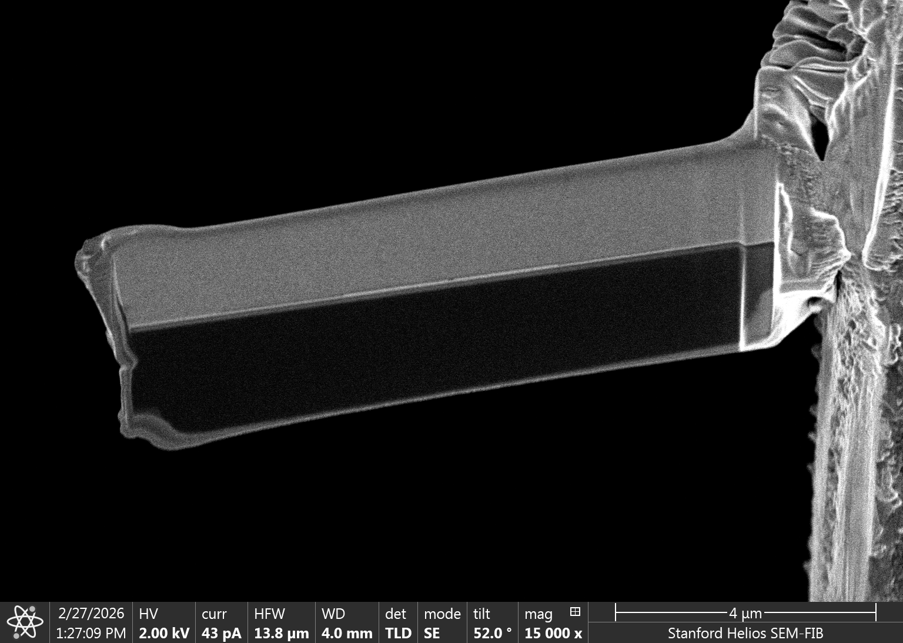
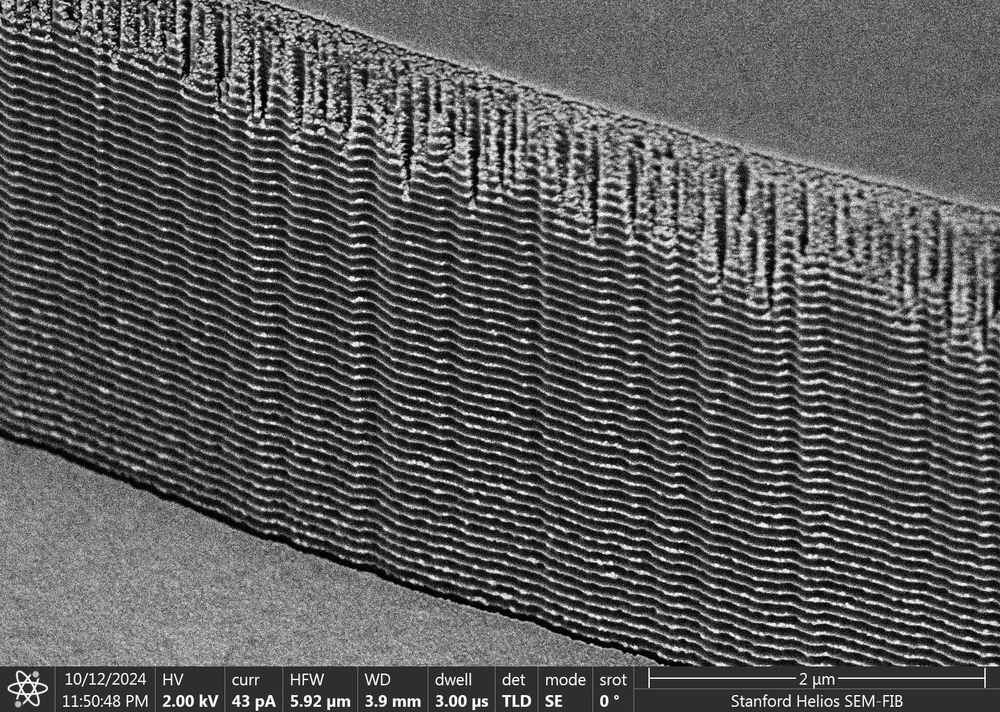

## Picture gallery

Microscopy images, process snapshots, and other pictures from the lab.

### 2D TMD Crystals

**Title:** Bulk WSe$_2$ Crystals on Silicon 
**Medium:** Solid-Source Chemical Vapor Deposition of WSe$_2$ on Silicon 
**Instrument:** Nikon LV100ND Optical Microscope, Dark-Field 
**Description:** Dark-field view of atomically thin WSe$_2$ crystals grown on silicon. 

**Title:** Sulfuric Starry Night 
**Medium:** Solid-Source Chemical Vapor Deposition of WSe$_2$ on Silicon 
**Instrument:** Nikon LV100ND Optical Microscope, Dark-Field 
**Description:** Optical micrograph of monolayer two-dimensional (2D) molybdenum disulfide (MoS2) irradiated with high-energy gamma rays at a total ionizing dose of 4.5 Mrad(Si). Sharp blue outlines represent triangular MoS$_2$ flakes, with bright spots indicating regions of very thick MoS$_2$. Bilayer islands and grain boundaries can also be seen inside the flakes. Bright blue specks on the edges of the triangles likely indicate damage/defect sites caused by radiation. 

Note: Stanford MRS Art of Science (2025) finalist, [view the gallery](https://mrs.groups.stanford.edu/art-science/art-science-2025#gallery).

### Electron-beam patterning

**Title:** MoS$_2$ Cat 
**Medium:** Etched MoS$_2$ on Silicon 
**Instrument:** Thermo-Fisher Hydra Scanning Electron Microscope 
**Description:** Sunglasses-wearing cat. Patterned with a Raith EBPG 5200+ and etched into MoS$_2$ with XeF$_2$. 

**Title:** I Heart 2D MoS$_2$ 
**Medium:** Etched MoS$_2$ on Silicon 
**Instrument:** Thermo-Fisher Hydra Scanning Electron Microscope 
**Description:** “I Heart 2D” logo. Patterned and etched into MoS$_2$. 

**Title:** Raith EBPG 5200+ 
**Medium:** Etched MoS$_2$ on Silicon 
**Instrument:** Thermo-Fisher Hydra Scanning Electron Microscope 
**Description:** Raith EBPG 5200+ image, rendered in black and white. Patterned with Raith EBPG 5200+ and etched with XeF$_2$. 

**Title:** Stanford S 
**Medium:** Etched MoS$_2$ on Silicon 
**Instrument:** Thermo-Fisher Hydra Scanning Electron Microscope 
**Description:** Stanford S logo. Patterned with Raith EBPG 5200+ and etched with XeF$_2$. 

### Transmission Electron Microscopy (TEM) Lamellae

**Title:**  
**Medium:** Back-gated MoS$_2$ Transistor on Silicon, attached to copper TEM half-grid 
**Instrument:** Thermo-Fisher Helios DualBeam Scanning Electron Microscope 
**Description:** Back-gated MoS$_2$ transistor, sandwiched between platinum and silicon; lamella is welded to a copper TEM half-grid (right). 

**Title:** Lamella 2 
**Medium:** Back-gated MoS$_2$ Transistor on Silicon, attached to copper TEM half-grid 
**Instrument:** Thermo-Fisher Helios DualBeam Scanning Electron Microscope 
**Description:** Wider view of the lamella and copper TEM half-grid, approximately one-quarter fingernail-sized. 

### Etch profiles

**Title:** Silicon Dunes 
**Medium:** AuPd-Coated Etched Silicon
**Instrument:** Thermo-Fisher Helios DualBeam Scanning Electron Microscope 
**Description:** DRIE-fabricated silicon trench; AuPd coating highlights the cyclical scalloped sidewall profile. 

**Title:** Scalloped etch profile 2 
**Medium:** Platinum on AuPd-Coated Etched Silicon
**Instrument:** Thermo-Fisher Helios DualBeam Scanning Electron Microscope 
**Description:** Wide view of scalloped silicon sidewalls with columnar, ion-beam-deposited platinum grains. 

**Title:** Sidewall etch profile 
**Medium:** Silicon
**Instrument:** Thermo-Fisher Helios DualBeam Scanning Electron Microscope 
**Description:** DRIE-etched silicon sidewall; charge concentration brightens the scallop tips and obscures the wavy surface, making it appear sharp and ladder-like. 
